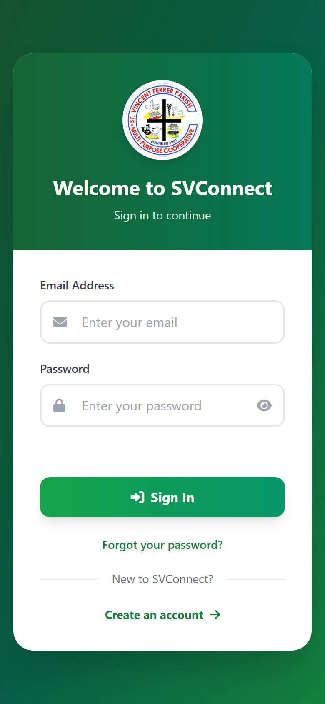
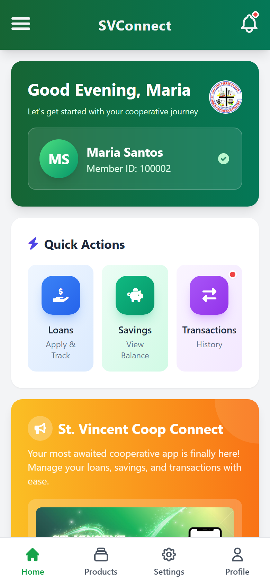
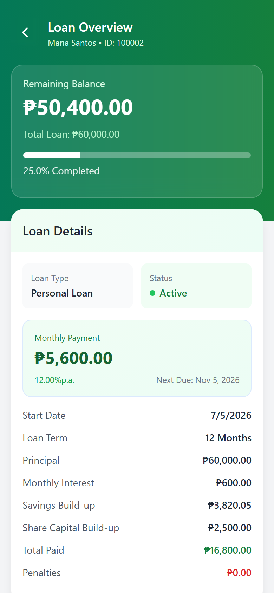
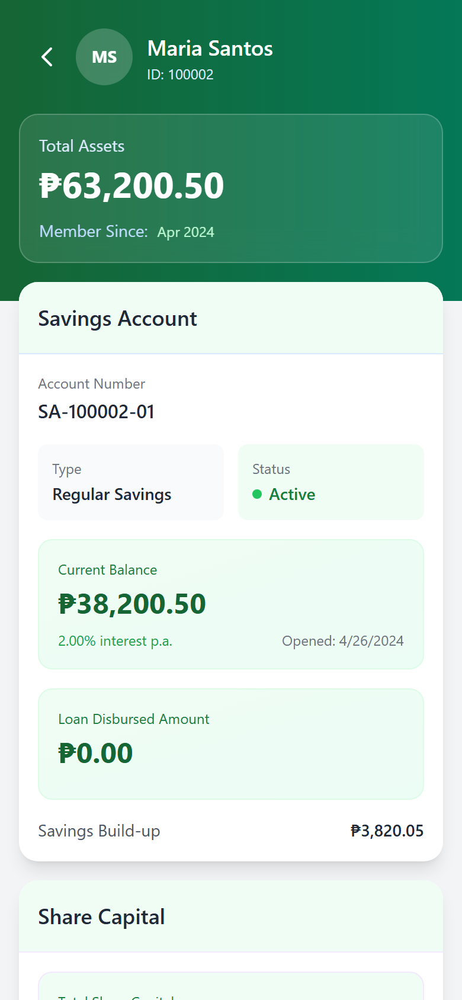
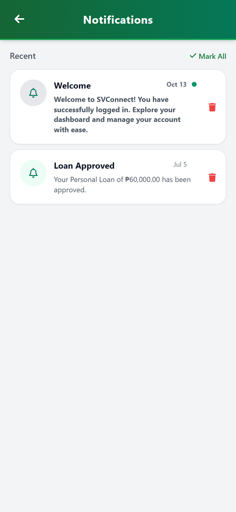
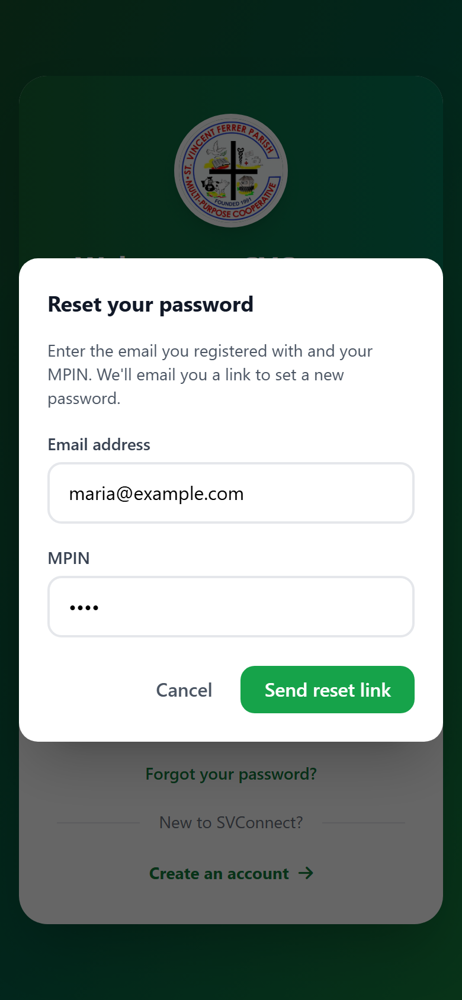

# SVConnect Mobile Application

[](https://github.com/quintuckyy/Application-SVConnect/actions/workflows/ci.yml)

SVConnect is the member-facing mobile app for St. Vincent Ferrer Multi-Purpose Cooperative (SVFMPC) in Romblon. Members can check their savings, track loan applications, review transaction history, and see cooperative announcements from their phone instead of having to go to the office for every inquiry. It pairs with a separate web admin dashboard that staff use to manage member records.

It was built as a capstone project by Quinn Agas and Neil Patrick Atienza and has since been approved by SVFMPC management for turnover. See [Credits](#credits).

## Screenshots

<table>
  <tr>
    <td align="center"><br>Sign in</td>
    <td align="center"><br>Home</td>
    <td align="center"><br>Loan overview</td>
  </tr>
  <tr>
    <td align="center"><br>Savings</td>
    <td align="center"><br>Notifications</td>
    <td align="center"><br>Password reset (masked MPIN)</td>
  </tr>
</table>

Captured from the app running against the Firebase emulators with the fictional seed data (`npm run seed:emulator`).

**Try it on Android:** every CI run on `main` builds a debug APK connected to the live demo project. Open the [latest successful run](https://github.com/quintuckyy/Application-SVConnect/actions/workflows/ci.yml?query=branch%3Amain+is%3Asuccess) and download `svconnect-debug-apk` under Artifacts (requires a GitHub login).

---

## Tech Stack

- JavaScript (ES modules), HTML, Tailwind CSS 3
- Vite (build and dev server), Capacitor 7 (Android)
- Firebase Authentication and Cloud Firestore (Firebase JS SDK from npm)
- Cloud Functions for Firebase (TypeScript, Node 22) and Firestore Security Rules
- Firebase Emulator Suite for local development and integration tests
- Supabase (home-screen announcements)
- Vitest (unit, Security Rules and Cloud Functions tests), ESLint, Prettier

---

## Features

- Registration and login, with email verification and password reset
- Home dashboard with quick actions and the current cooperative announcement
- Loan browsing, application submission, status tracking, and a completed-loans history
- Savings balance and transaction history
- In-app notifications
- Profile and settings (dark mode included)
- Customer support, FAQs, terms & conditions, and an about-the-cooperative page

---

## Architecture and security

The app is a client for Firebase. Anything that has to be trusted runs on the server:

| Action                                       | Where it runs                                    | Why                                                                                                                                 |
| -------------------------------------------- | ------------------------------------------------ | ----------------------------------------------------------------------------------------------------------------------------------- |
| Check a Member ID during registration        | `checkMemberId` function                         | Returns only a status, so member records stay private                                                                               |
| Link a login to a member, store the MPIN     | `completeRegistration` function                  | Sets the `memberId` custom claim and stores the MPIN with scrypt in `memberSecrets`                                                 |
| Submit a loan application                    | `submitLoanApplication` function                 | Applies the loan rules on the server, in a transaction that blocks double submission; status and interest rate come from the server |
| Overdue flags and the 2% penalty             | `applyLoanPenalties`, daily at 00:30 Manila time | Previously computed on the phone when the app was opened                                                                            |
| Forgot-password MPIN check, account deletion | `verifyPasswordResetMpin`, `deleteMyAccount`     | MPIN checks with a 5-attempt lockout; deletion requires a sign-in within 5 minutes                                                  |

[`firestore.rules`](firestore.rules) lets a member read only their own records and change only their display name and the read state of notifications and transactions. MPIN hashes can't be read from the app at all. The loan rules and the overdue logic live in `www/js/lib/` and are shared by the app (instant feedback) and the Cloud Functions (enforcement).

In the app itself:

- Text from the database is escaped before it goes into HTML (`www/js/lib/html.js`), so stored markup can't run as script.
- `app.html` sends signed-out or unverified users back to the login page, and each screen waits for the session once per visit (`services/session.js`) instead of adding a new auth listener every time it opens.
- Failed loads show a message (`services/ui.js` → `showError`) instead of failing silently or leaving a spinner running.

The screens call `www/js/services/api.js`, which uses the Cloud Functions when `VITE_USE_CLOUD_FUNCTIONS=true` and otherwise falls back to doing the same work in the app. The fallback exists because deploying Cloud Functions needs Firebase's Blaze plan; the strict rules are only safe to deploy together with the functions.

---

## Project structure

```
SVConnect/
├── android/                 # Capacitor-generated native Android project
├── functions/               # Cloud Functions (TypeScript, bundled with esbuild)
│   └── src/                 # registration, loans, account, penalties, mpin
├── scripts/
│   └── seed-firestore.mjs   # fills a Firestore project with fictional test data
├── tests/
│   ├── unit/                # pure logic, no Firebase
│   └── emulator/            # Security Rules and Cloud Functions, against the emulators
├── www/                     # app source (Vite root)
│   ├── index.html           # login
│   ├── register.html
│   ├── app.html             # shell for the logged-in app
│   ├── styles.css           # Tailwind + Font Awesome, compiled by Vite
│   ├── public/img/          # images, copied as-is into the build
│   └── js/
│       ├── app.js           # hash router
│       ├── login.js         # registration, login, password reset
│       ├── screens/         # one file per screen (render + init)
│       ├── lib/             # pure logic shared with Cloud Functions: loan rules, overdue rules, MPIN hashing
│       └── services/        # Firebase setup, Firestore queries, api.js (server actions), Supabase
├── firestore.rules          # Security Rules
├── firebase.json            # Firebase CLI and emulator config
├── .env.example             # copy to .env and fill in
├── .env.emulator            # settings for `npm run dev:emulator`
├── vite.config.js
├── capacitor.config.json    # webDir: dist (the Vite build output)
└── package.json
```

---

## Running it locally

You'll need Node.js 22 or newer, and Java 21 for the Firebase emulators.

**Fully local, with Cloud Functions (recommended).** Everything runs on your machine against the Firebase Emulator Suite; no Firebase project or keys needed.

```bash
npm install
npm run emulators        # terminal 1: Auth, Firestore and Functions emulators, UI at http://localhost:4000
npm run seed:emulator    # terminal 2: fictional members and loan products
npm run dev:emulator     # terminal 2: the app at http://localhost:5503
```

Register with Member ID 100001, 100002 or 100003. The emulator doesn't send emails: open the Emulator UI → Authentication to verify the account's email.

**Against a real Firebase project.**

```bash
cp .env.example .env    # then fill in your Firebase and Supabase values
npm run dev
```

| Command                                                | What it does                                                    |
| ------------------------------------------------------ | --------------------------------------------------------------- |
| `npm run dev`                                          | Dev server with hot reload                                      |
| `npm run build`                                        | Production build into `dist/`                                   |
| `npm run preview`                                      | Serve the production build                                      |
| `npm test`                                             | Run the unit tests                                              |
| `npm run test:emulator`                                | Security Rules and Cloud Functions tests (starts the emulators) |
| `npm run lint`                                         | ESLint                                                          |
| `npm run format`                                       | Prettier                                                        |
| `npm run android`                                      | Build and copy into the Android project                         |
| `npm run seed`                                         | Write fictional test data to Firestore (see below)              |
| `npm run emulators` / `seed:emulator` / `dev:emulator` | Local development with the emulators                            |

Capacitor plugins like Push Notifications only work in the native build, not in the browser.

**Continuous integration.** Every push to `main` and every pull request runs [GitHub Actions](.github/workflows/ci.yml): formatting, lint, unit tests, the Cloud Functions type-check and the production build; the Security Rules and Cloud Functions tests against the emulators; and an Android debug build, whose APK is attached to the run.

---

## Building the Android app

You need a JDK (21 — Capacitor 7's Android library won't compile on 17) and the Android SDK. Android Studio isn't required, the command-line tools are enough.

1. Install JDK 21 and the SDK (`platform-tools`, `platforms;android-35`, `build-tools;35.0.0`).
2. Point Gradle at your SDK in `android/local.properties` (gitignored, machine-specific):
   ```properties
   sdk.dir=C:\\path\\to\\Android\\Sdk
   ```
3. Build the web app and sync it into the native project:
   ```bash
   npm run android
   ```
4. Build:
   ```bash
   cd android
   ./gradlew.bat assembleDebug   # Windows
   ./gradlew assembleDebug       # macOS/Linux
   ```
   The APK lands in `android/app/build/outputs/apk/debug/app-debug.apk`.

A release build additionally needs a signing keystore referenced from `android/app/build.gradle` — see the security notes below before generating or reusing one.

---

## Firebase / Supabase / OneSignal setup

The web app reads its Firebase and Supabase settings from `.env` (see `.env.example`). Firebase web config isn't secret; access is controlled by Firestore Security Rules.

1. Create a Firebase project, enable Email/Password sign-in, and create a Firestore database.
2. Put the web app config in `.env`.
3. Seed test data: Project settings → Service accounts → Generate new private key, save it as `serviceAccountKey.json` in the repo root (gitignored), then run `npm run seed`. Register in the app with Member ID 100001, 100002 or 100003. The script refuses to write to any project except the one named in it.
4. For Android push notifications, download your own `google-services.json` into `android/app/` and set your own `onesignal_app_id` in `AndroidManifest.xml`.

**Security Rules for each setup.** There are two rule sets, and the one deployed must match how the app runs:

| Setup                                                                  | Rules                                                                                                                | Deploy                                       |
| ---------------------------------------------------------------------- | -------------------------------------------------------------------------------------------------------------------- | -------------------------------------------- |
| Cloud Functions deployed (Blaze plan), `VITE_USE_CLOUD_FUNCTIONS=true` | [`firestore.rules`](firestore.rules): strict                                                                         | `firebase deploy --only functions,firestore` |
| No Cloud Functions (Spark plan), `VITE_USE_CLOUD_FUNCTIONS=false`      | [`firestore.fallback.rules`](firestore.fallback.rules): allows exactly the writes the app makes itself, nothing else | `npm run deploy:rules -- fallback`           |

The live project currently runs the fallback rules. Their limits compared with Cloud Functions are listed at the top of the file; both rule sets are tested against the emulator (`npm run test:emulator`).

The home-screen announcement comes from a Supabase `announcements` table. If the Supabase variables are empty, the banner keeps its default content.

---

## Project Summary

SVConnect Mobile Application is a member-facing app developed as a capstone project for St. Vincent Ferrer Multi-Purpose Cooperative in Romblon. It allows members to apply loans, view savings records, transaction history, announcements, and notifications from their phone.

---

## Future Improvements

- Add offline support for unreliable mobile connections
- Improve push notifications for loan updates, announcements, and payment reminders
- Add end-to-end tests (Playwright) for the main member flows
- Replace the default Android package name before production release
- Extend CI to signed release builds and Play Store delivery
- Improve error handling, loading states, and mobile responsiveness
- Deploy the Cloud Functions and Security Rules to production (needs the Blaze plan) and add App Check
- Add detailed loan payment tracking and due date reminders

## Project Status

Completed as a capstone project and approved by St. Vincent Cooperative management for turnover. This repository has since added server-side validation, Security Rules, automated tests and CI. Further improvements may include production package naming, signed release builds, and offline support.

---

## Credits

SVConnect was built as a capstone project by **Quinn Agas** and **Neil Patrick Atienza** for St. Vincent Ferrer Multi-Purpose Cooperative.

This repository is Quinn Agas's continuation of that project. The original application was imported in the first commit; the changes since then (the Vite build, Cloud Functions and Security Rules, the test suites and CI) are listed in the commit history.
